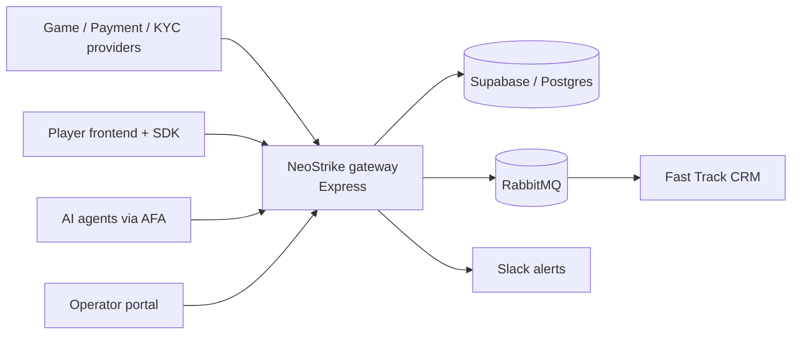

# iGaming Prototype with Fast Track Integration (NeoStrike)

NeoStrike is a multi-tenant, AI-native iGaming integration platform. It sits between game/payment/KYC providers, the operator's wallet and player experience, and the [Fast Track](https://www.fasttrack.ai) CRM, and exposes an **Agent-Friendly API (AFA)** so AI agents (e.g. Claude CoWork) can monitor and operate the platform within operator-defined trust limits.

This repository is a working prototype: backend gateway, operator portal, player reference frontend, SDK, casino scaffold and a game simulator.

## Features

| Area | What it does |
| :--- | :--- |
| **Seamless Wallet SPI (F9)** | `debit`, `credit`, `rollback`, `deposit` with real/bonus balance separation |
| **Bonus engine (F8)** | Bonus templates, wagering contribution, suppression for at-risk players, lifecycle events |
| **Reporting & BI (F10)** | GGR / NGR, active players, bonus exposure, payment approval rate, anomaly flags |
| **Duty of Care (F11)** | Composite risk score (0–10), reality checks, mandatory breaks, self-exclusion, SSE alert stream |
| **Agent-Friendly API (F13)** | `/.well-known/agent.json` discovery, JWT agent tokens, three-tier trust model, analysis API, 7-year audit trail |
| **Fast Track integration** | Player, payment, casino, bonus, balance and sportsbook events published to Fast Track via RabbitMQ / HTTP |
| **Operator portal** | Dashboard, roles & permissions, KYC review, player notes, exports, country rules, affiliates, CMS, theming, i18n, integrations |
| **Sportsbook alpha** | Catalogue/event API, bet slip, cash-out, provider adapter, bet/settlement events to Fast Track |
| **Fraud & trust** | Fraud signals feed, collusion graph, ATO dashboard, bonus-abuse/burn-rate, trust-score timeline |
| **Reference frontend & SDK** | React lobby, game page, cashier, hooks (`useGames`, `useBalance`, `useGameLaunch`, `useSportsbook`, …) |

### AFA three-tier trust model

| Tier | Purpose | Example scopes | Approval |
| :--- | :--- | :--- | :--- |
| T1 Observe | Read metrics, alerts, audit logs | `metrics:read`, `alerts:read`, `audit:read` | Immediate |
| T2 Pre-authorised | Threshold-bound actions | `player:restrict:pre-auth`, `alerts:write:pre-auth` | Autonomous, audited |
| T3 Human-gated | High-impact actions | `player:exclude:human-gated`, `bonus:issue:human-gated` | Human approval |

## Architecture



## Repository layout

```
backend/     Express API gateway (routes, services, middleware, SQL migrations, jobs)
api/         Vercel serverless entrypoint (api/index.js)
frontend/    React 19 + Vite app: player experience and operator portal
sdk/         @neostrike/sdk – client, provider and React hooks/components
scaffold/    Casino scaffold app built on the SDK (Vite + React 18)
mock-game/   Game SPI simulator and mock provider/payment adapters
scripts/     Admin sync and flow/compliance verification scripts
```

Key backend areas: `backend/routes/` (`afa`, `afa-auth`, `operator`, `user`, `games`, `kyc`, `payments`, `promotions`, `providers`, `sportsbook`, `webhooks`, `phase1/2/4`), `backend/services/` (wallet, bonus management, RG scoring/limits, self-exclusion, AFA services, `ft-integration`, `rabbitmq`, `slack-service`, reporting), `backend/middleware/` (auth, AFA auth/policy/rate-limit, sandbox, feature gate).

## Tech stack

Node.js, Express 5, Supabase (Postgres), RabbitMQ (`amqplib`), Redis (`ioredis`, optional), Socket.IO, JWT, Helmet, express-rate-limit, Winston; React 19, Vite, Recharts, SWR; deployed on Vercel.

## Getting started

### Prerequisites
- Node.js 20+
- A Supabase project (apply the SQL files in `backend/migrations/` in order)
- Optional: RabbitMQ (e.g. CloudAMQP) for Fast Track event publishing

### Install and run

```bash
npm install              # installs root deps and backend deps (postinstall)
cd frontend && npm install
```

```bash
cd backend && npm run dev        # API on http://localhost:5000
```

```bash
cd frontend && npm run dev       # frontend on Vite's dev port
```

Optional apps:

```bash
cd scaffold && npm install && npm run dev        # casino scaffold on :5173
cd mock-game && npm install && node simulator.js  # fires bet/win rounds at the SPI
```

Production build (used by Vercel): `npm run build` at the repo root.

### Configuration

Create `backend/.env` (never commit it). Variables read by the backend:

| Variable | Purpose |
| :--- | :--- |
| `PORT` | API port (default `5000`) |
| `SUPABASE_URL`, `SUPABASE_ANON_KEY`, `SUPABASE_SERVICE_ROLE_KEY` | Database |
| `OPERATOR_API_KEY` | Master key for S2S calls (`x-api-key`) |
| `AFA_JWT_SECRET`, `AFA_WEBHOOK_SECRET` | AFA agent tokens and webhook signing |
| `FT_API_URL`, `FT_API_KEY`, `PLATFORM_ORIGIN` | Fast Track integration defaults (overridable per tenant) |
| `CLOUDAMQP_URL`, `RABBITMQ_QUEUE` | RabbitMQ event bus |
| `SLACK_WEBHOOK_URL` | Alert notifications |
| `PORTAL_URL`, `PRODUCT_OFFERING`, `DEMO_MODE`, `LOG_LEVEL`, `NODE_ENV` | Behaviour and environment |
| `PRAGMATIC_API_KEY`, `EVOLUTION_API_KEY`, `NETENT_API_KEY` | Game provider keys |
| `SUMSUB_WEBHOOK_SECRET`, `NUVEI_WEBHOOK_SECRET`, `GAMSTOP_API_KEY`, `GAMSTOP_MOCK_MODE` | KYC, payments, self-exclusion |

## API overview

| Group | Endpoints |
| :--- | :--- |
| Wallet SPI | `POST /api/debit`, `/api/credit`, `/api/rollback`, `/api/deposit` |
| Reporting | `GET /api/stats/summary`, `GET /api/stats/live` |
| Webhooks | `POST /api/webhooks/fasttrack` |
| AFA | `GET /.well-known/agent.json`, `/api/v1/ops/*` (metrics, alerts, actions, events stream, audit), `/api/v1/auth/agent-tokens` |
| Domain APIs | `/api/v1/games`, `/api/v1/kyc`, `/api/v1/payments`, `/api/v1/sportsbook`, `/api/providers`, `/api/promotions` |
| Health | `GET /health` |

Requests use `x-api-key` for S2S auth and `x-brand-id` to select the tenant. Send `x-sandbox-mode: true` to exercise integrations without a live database or CRM. A Postman collection is in [neostrike-postman.json](neostrike-postman.json); see also [README_DEVELOPER.md](README_DEVELOPER.md).

## Fast Track integration

`backend/services/ft-integration.js` maps platform events to Fast Track integration endpoints and publishes them through RabbitMQ:

| Event | Fast Track endpoint |
| :--- | :--- |
| registration / user update | `/v2/integration/user` |
| login / logout | `/v2/integration/login`, `/v2/integration/logout` |
| consents / blocks | `/v2/integration/user/consents`, `/v2/integration/user/blocks` |
| deposit / withdrawal | `/v1/integration/payment` |
| bet / win | `/v1/integration/casino` |
| bonus | `/v1/integration/bonus` |
| balance | `/v1/integration/user/balances` |
| sportsbook bet / settlement | `/v1/integration/sports` |

Fast Track-driven bonus and responsible-gaming actions return through `POST /api/webhooks/fasttrack`.

## Documentation

- [product_feature_guide.md](product_feature_guide.md) – full product feature guide
- [cowork_demo_guide.md](cowork_demo_guide.md) – Claude CoWork + AFA demo scenarios and prompts
- [README_DEVELOPER.md](README_DEVELOPER.md) – integrator quick start
- PRDs (`NeoStrike_*_PRD*.docx`): SDK, Duty of Care (F11), Frontend upgrade (F12), AFA (F13), Phases 1–4, plus the BetNexus comparison and sales decks

## Status

Prototype. Phases 1–4 of the product roadmap are implemented; there is no automated test suite yet (`npm test` is a placeholder). Do not use the default demo keys outside local development.
