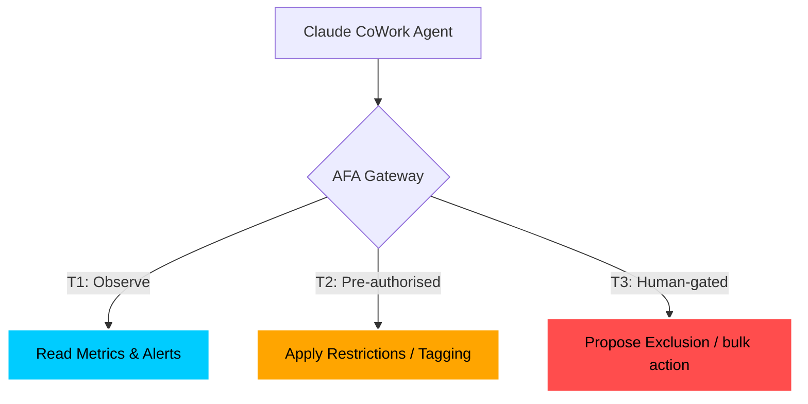

# 🚀 Claude CoWork & AFA: The Autonomous Operator Guide

Welcome to the future of iGaming operations. This guide demonstrates how to leverage **Claude CoWork** alongside the **NeoStrike Agent-Friendly API (AFA)** to automate routine monitoring, risk analysis, and player interventions—safe in the knowledge that human judgment is always just an escalation away.

---

## 🏛️ The Three-Tier Trust Model

AFA governs all agent actions through a strictly enforced trust hierarchy. This ensures that agents only take the actions you've pre-authorised.



---

## 🛠️ Step 1: Zero-Config Discovery (Phase 1)

NeoStrike implements the **Agent Discovery Standard**. When you connect Claude CoWork to your platform URL, it automatically finds the manifest to self-configure.

> [!TIP]
> Your discovery manifest is live at: `/.well-known/agent.json`

### Creating an Agent Token
1.  Navigate to **Operator Portal** -> **Settings** -> **Agent Gateway**.
2.  Click **Issue New Token**.
3.  Assign **Agent Label** (e.g., `cowork-alpha`).
4.  Select **T1 Scopes** (`metrics:read`, `alerts:read`) for observation.
5.  Select **T2 Scopes** (`player:restrict:pre-auth`) for autonomous intervention.
6.  **Copy the JWT** immediately.

---

## 📡 Scenario 1: The "Daily Pulse" (Tier 1)

**Objective**: CoWork monitors platform health and alerts you only when thresholds are crossed.

**Instruction to CoWork**:
> "Monitor the AFA Summary Metrics every hour. If the GGR drop exceeds 15% WoW or Active Players fall below 500, fetch the top 10 RG alerts and summarize the likely cause."

**What happens behind the scenes**:
1.  **Metric Fetch**: `GET /v1/ops/metrics/summary?period=today&compare_period=7d`
2.  **Alert Triage**: If thresholds are hit, CoWork calls `GET /v1/ops/alerts?status=open&limit=10`.
3.  **Outcome**: CoWork sends you a message: *"GGR is down 18% WoW. 6 alerts found. Main trigger: Velocity Spikes in Germany."*

---

## 🛡️ Scenario 2: Autonomous Defensive Play (Tier 2)

**Objective**: Prevent player harm instantly when high-risk patterns are detected.

**Instruction to CoWork**:
> "Watch the AFA SSE event stream. If you see an `rg_alert_created` event with a composite risk score > 80, immediately RESTRICT the player for 24 hours with the reason 'Automated Reality Check' and acknowledge the alert."

**What happens behind the scenes**:
1.  **SSE Listen**: `GET /v1/ops/events/stream` (receives `rg_alert_created`).
2.  **Decision**: Agent sees `composite_risk_score: 85`.
3.  **T2 Action**: `POST /v1/ops/actions/players/{id}/restrict` with `{ "type": "break", "duration": 24, "reason": "Automated Reality Check" }`.
4.  **Acknowledge**: `PATCH /v1/ops/alerts/{id}/status` with `{ "status": "acknowledged", "agent_note": "Restricted via CoWork policies." }`.

> [!IMPORTANT]
> **Audit Trail**: Every T2 action is logged in the **Agent Audit Log** with the specific token ID and reason, ensuring 100% regulatory compliance.

---

## ⚖️ Scenario 3: The Human-in-the-Loop (Tier 3)

**Objective**: Escalate complex cases that require human judgment, such as permanent self-exclusions.

**Instruction to CoWork**:
> "If a player profile indicates a high `chasing_losses` score over 30 days, do NOT restrict them. Instead, ESCALATE to the human queue for a permanent exclusion review."

**What happens behind the scenes**:
1.  **Analysis**: CoWork reviews `GET /v1/ops/alerts?player_id={id}`.
2.  **T3 Proposal**: `POST /v1/ops/actions/escalations` with the payload `{ "type": "permanent_exclusion", "player_id": "{player_id}" }`.
3.  **Operator Experience**: Your Welfare team sees a new **"Pending Approval"** item in the Portal. They click **Approve** to execute.

---

## 🚦 Regulatory Assurance & Control

- **Revoke Instantly**: If an agent starts behaving unexpectedly, click **Revoke** in the Agent Tokens panel. The JWT is invalidated globally in < 100ms.
- **Rate Limits**: Agents are rate-limited per API group (Metrics, Alerts, Actions) to prevent platform strain.
- **Immutability**: Agent audit logs are stored for **7 years** and cannot be deleted or modified, even by Super Admins.

---

## 🚀 Get Started Now
Your platform is AFA-ready. Open your [Agent Gateway Settings](file:///Users/czuo/Desktop/iGaming%20Integration%20Platform%20V2/frontend/src/portal/components/AgentTokensPanel.jsx) to issue your first CoWork token!

---

## 🎯 Demo Prompt Library

Copy and paste these prompts into your Claude CoWork session to demonstrate the power of AFA.

````carousel
### 1. The Handshake
"Initialize connection to the NeoStrike AFA layer at `https://[your-platform-url]/.well-known/agent.json`. Use the JWT provided. Once connected, confirm your active trust tier and list your available capabilities."
<!-- slide -->
### 2. Routine Monitoring (T1)
"Check the GGR summary for 'today' compared to the same day last week. If you detect a variance greater than 10%, query the active RG alerts and provide a bulleted summary of the top 3 players currently contributing to the risk score."
<!-- slide -->
### 3. Automated Shield (T2)
"Monitor the `/v1/ops/events/stream` for `rg_alert_created` events. If an event has a `composite_risk_score` over 80, immediately apply a '24-hour break' restriction to that player. Add an agent note: 'Automated safety intervention via AFA policy T2'."
<!-- slide -->
### 4. Strategic Escalation (T3)
"Identify any player who has triggered a 'velocity_spike' more than 3 times in 48 hours. Do not restrict them automatically. Instead, create a T3 escalation record proposing a permanent exclusion review, citing 'sustained pattern of high-frequency loss chasing'."
````

> [!TIP]
> **Pro-Tip**: For the best results, set Claude CoWork's system persona to: *"You are an Expert iGaming Compliance Agent operating the NeoStrike platform via the Agent-Friendly API. Your priority is player safety and GGR stability within operator-defined policy bounds."*
