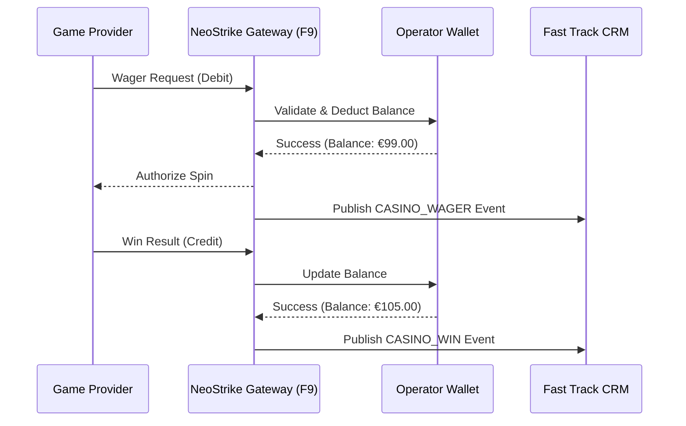
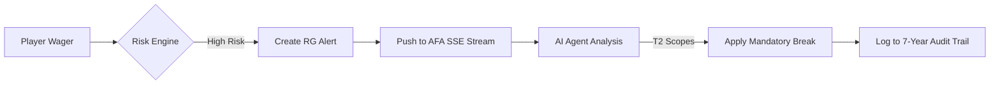

# 🚀 NeoStrike: The Master Product Feature Guide (v2.0)

Welcome to the definitive manual for **NeoStrike v2.0**—the industry's first **AI-Native iGaming Integration Platform**. This document provides an exhaustive technical and functional breakdown of the platform's core modules, from financial transactional integrity to autonomous AI operations.

---

## 🏛️ 1. Platform Vision & Core Architecture
NeoStrike is a multi-tenant, cloud-native integration layer designed to provide **maximum operational leverage**. We eliminate the manual overhead of iGaming operations by embedding intelligence directly into the integration gateway.

- **Unified Gateway**: A single entry point for all S2S (Server-to-Server) and Client-side interactions.
- **Multi-Tenant SaaS**: Support for hundreds of independent operator brands (Tenants) on a single, scalable infrastructure.
- **Event-Driven Core**: Built on a robust message bus (RabbitMQ) to ensure real-time data flow across CRM, BI, and Compliance modules.

---

## 💳 2. Financial Services Core (F9)
The NeoStrike financial engine is built for **zero-latency transactional integrity**. It acts as the "Source of Truth" between game providers and the operator's core wallet.

### 🔄 Seamless Wallet SPI
Our Financial SPI (Service Provider Interface) ensures atomic transactions across all providers.
- **`POST /api/debit`**: Atomically deducts funds for a wager.
- **`POST /api/credit`**: Instantly credits player winnings.
- **`POST /api/rollback`**: Reverts transactions in the event of provider timeouts or errors.
- **`POST /api/deposit`**: Handles real-time cashier inflows with instant balance synchronization.

### 📊 Financial Transaction Flow

---

## 🎁 3. Promotional & Bonus Engine (F8)
NeoStrike provides a sophisticated bonus management layer that integrates seamlessly with third-party CRMs like Fast Track.

- **Multi-Wallet Support**: Intelligent separation between **Real Money** and **Bonus Money**.
- **Wagering Contribution**: Real-time tracking of wagering progress based on game-specific contribution factors (e.g., Slots 100%, Table Games 10%).
- **Bonus Suppression**: Automated logic to prevent bonus abuse or restrict bonuses for high-risk players (F11 integration).
- **Lifecycle Events**: Full tracking of bonus status: `Issued`, `Active`, `Completed`, `Forfeited`, or `Expired`.

---

## 📈 4. Reporting & BI Intelligence (F10)
Our BI module provides real-time visibility into platform health and commercial performance.

### 📊 Key Performance Indicators (KPIs)
| Metric | Description | Resolution |
| :--- | :--- | :--- |
| **GGR** | Gross Gaming Revenue (Total Bets - Total Wins). | Real-time |
| **NGR** | Net Gaming Revenue (GGR - Bonuses - Taxes). | Real-time |
| **Active Players** | Unique players with at least one transaction in the period. | Hourly |
| **Bonus Exposure** | Total liabilities held in active bonus wallets. | Real-time |
| **Approval Rate** | Success rate of payment deposit attempts. | Real-time |

> [!TIP]
> **Anomaly Detection**: F10 automatically flags statistically significant drops in GGR or sudden spikes in payment failures, notifying operators via Slack or the AFA Monitor.

---

## 🤖 5. Agent-Friendly API (F13 - AFA)
The signature innovation of v2.0. AFA enables **autonomous operation** by AI agents (e.g., Claude CoWork), reducing the need for constant human monitoring.

### 🛡️ The Three-Tier Trust Model
| Tier | Permissions | Scopes | Approval |
| :--- | :--- | :--- | :--- |
| **Tier 1: Observe** | Metrics, Alerts, Logs. | `metrics:read`, `alerts:read`, `audit:read` | Immediate |
| **Tier 2: Pre-auth** | Threshold-based actions. | `player:restrict:pre-auth`, `alerts:write:pre-auth` | Autonomous |
| **Tier 3: Gated** | High-impact regulatory actions. | `player:exclude:human-gated`, `bonus:issue:human-gated` | Human |

### 🔍 Analysis API
The Analysis API (`POST /v1/ops/analysis/alerts/{id}`) provides structured AI diagnoses of player behavior. Instead of raw data, agents receive a curated output:
- **Severity**: Critical / High / Medium / Low.
- **Likely Cause**: e.g., "Velocity Spike Detected in Germany".
- **Recommended Action**: e.g., "Trigger 24h Mandatory Break".

---

## 💎 6. Reference Frontend v2.0 (Player Experience)
A premium, React-based frontend kit inspired by **Slott.com**.

### 🎮 Lobby Architecture
- **Horizontal Category Bar**: 10 distinct categories including `Top Games`, `Live Casino`, and `Bonus Buy`.
- **Mechanic Chips**: Deep-filtering for **Provider, RTP (94%+), Volatility, and Max Win**.
- **SEO Optimized**: Deep-linkable category pages and zero-layout shift loading.

### 🕹️ Individual Game Page
- **Slott-Inspired Sidebar**:
    - **Game stats**: RTP, Volatility, Max Win.
    - **Session history**: Real-time list of spins and net results.
    - **Related Games**: Similarity-matched recommendations to drive session depth.
- **Demo/Real Toggle**: Native support for switching between free-play and real-money modes via the `useGameLaunch` hook.

---

## ⚖️ 7. Compliance & Duty of Care (F11)
Regulatory safety is baked into the platform, not bolted on.

- **Composite Risk Scoring**: An F11 engine that assigns a risk score (0-10) based on financial velocity, chase-loss behavior, and session duration.
- **SSE Event Stream**: Real-time push of `rg_alert_created` events for immediate agent response.
- **Automated Interventions**:
    - **Reality Check**: Scheduled UI prompts informing the player of their session time.
    - **Mandatory Break**: Threshold-based blocking of account access for 24-72 hours.
    - **Bonus Suppression**: Automatic removal of promotional eligibility for "At Risk" players.

### 🛡️ Compliance Event Flow

---

## 🎮 8. Proprietary Innovation: NeoStrike Demo Slot
A unique, self-contained HTML5 slot game (3-reel, 1-payline) used for sales demos and operator onboarding.
- **Seamless Wallet Bridge**: Demonstrates the postMessage integration between an iframe-based game and the platform wallet.
- **Wager/Win Simulation**: Generates legitimate financial events that can be viewed in the **Fast Track Event Feed** and **AFA Dashboard**.

---

## 🛠️ 9. Developer Experience (DX)
- **Sandbox Mode**: Use `x-sandbox-mode: true` to simulate any provider response or failure state.
- **OpenAPI 3.1**: Globally accessible, machine-readable documentation at `/.well-known/agent.json`.
- **7-Year Audit Trail**: Every API call (human or agent) is recorded in an immutable, regulatory-grade audit log.

---

> [!NOTE]
> **Getting Started**: 
> 1. Issue an Agent Token in the [Operator Portal Settings](file:///Users/czuo/Desktop/iGaming%20Integration%20Platform%20V2/frontend/src/portal/components/AgentTokensPanel.jsx).
> 2. Connect your [Claude CoWork Agent](file:///Users/czuo/Desktop/iGaming%20Integration%20Platform%20V2/cowork_demo_guide.md).
> 3. Start monitoring your platform GGR in real-time.
